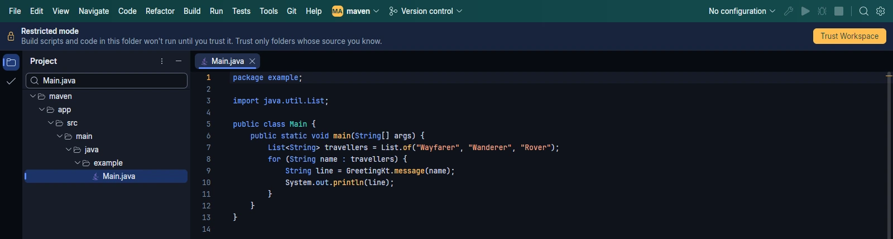
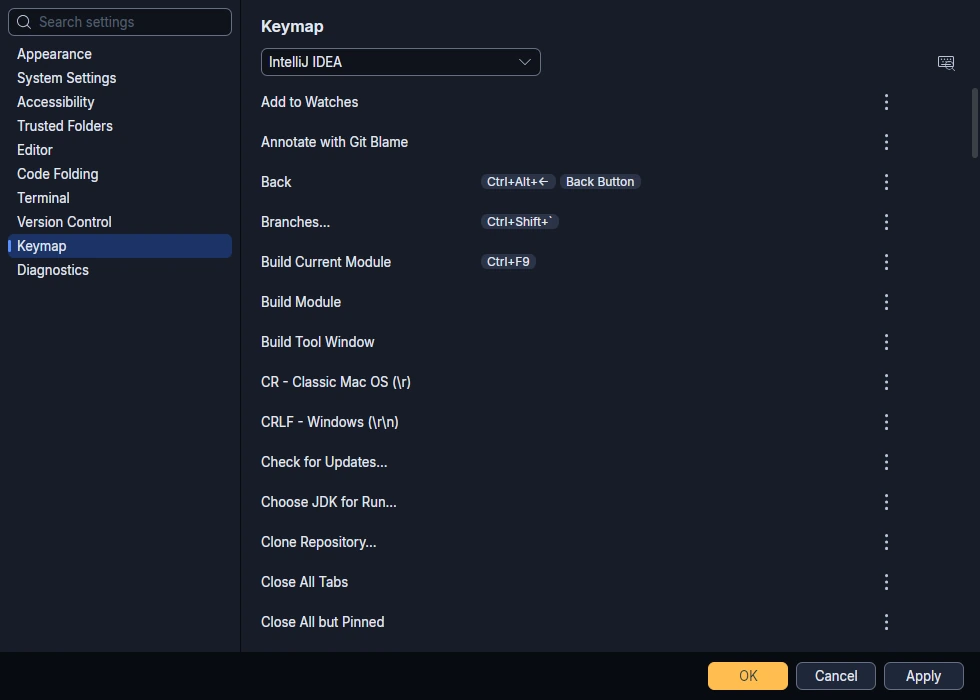
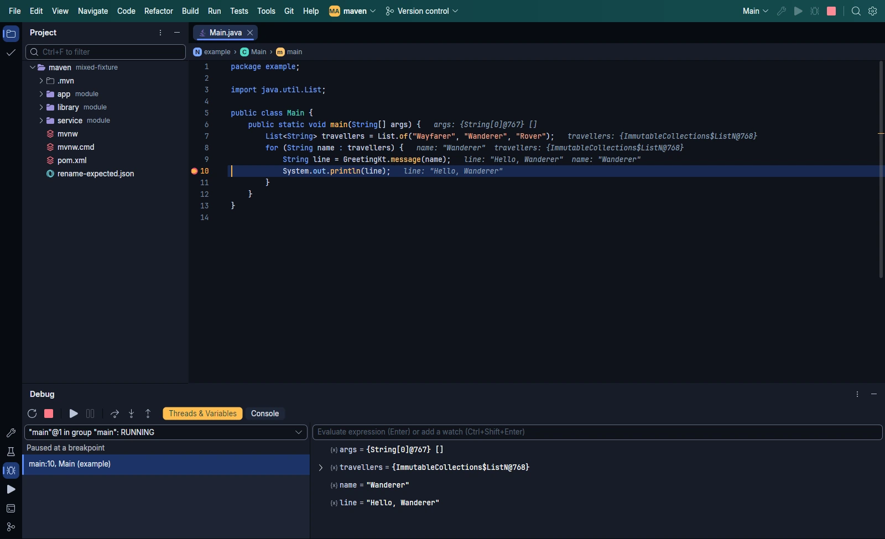
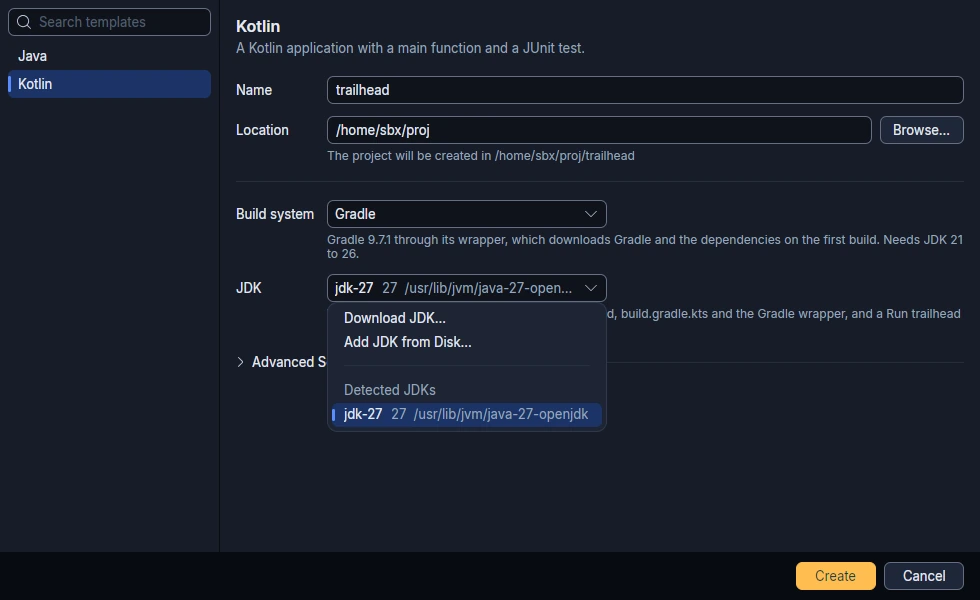
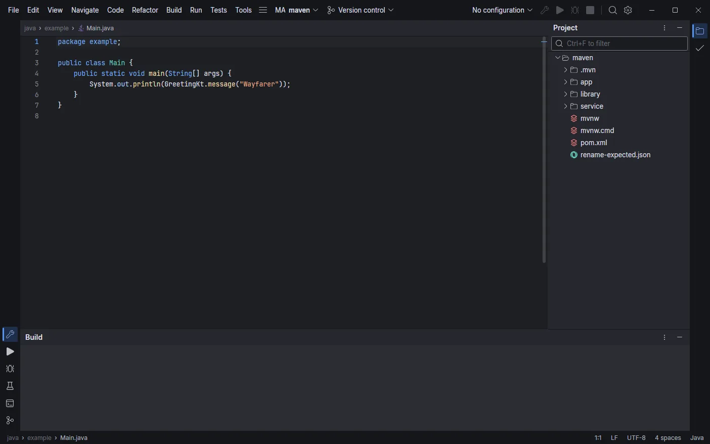

<!-- The top half follows the landing page (site/layouts/home.html, facts in site/data/product.yaml).
     Pictures: docs/readme/, taken from the running app; theme renders: site/static/img/. -->

<p align="center">
  
</p>

<p align="center">
  <a href="#get-started"><b>Get started</b></a> ·
  <a href="#features">Features</a> ·
  <a href="#how-it-works">How it works</a> ·
  <a href="#questions">FAQ</a> ·
  <a href="#development">Development</a>
</p>

<p align="center"><sub>v0.1.0 · Windows, macOS and Linux · First release pending. Download links go live with v0.1.0 on
<a href="https://github.com/kzagoris/wayfarer-wanderer/releases">GitHub Releases</a>.</sub></p>

## Features

### Your Java calls Kotlin. Your IDE should follow it there.

Mixed repositories are normal. Each file goes to the language server that owns it: JDT LS for Java,
kotlin-lsp for Kotlin. On Maven, Wayfarer compiles your Kotlin with the project's wrapper so Java sees
its declarations. <kbd>Ctrl</kbd> <kbd>B</kbd> crosses the line.

<p align="center">
  
</p>
<p align="center"><sub>Quick Documentation (<kbd>Ctrl</kbd> <kbd>Q</kbd>) on a Kotlin function, called from Java. The project is
<code>tests/fixtures/jvm/maven</code>, the one Wayfarer's tests open, with a loop added for the picture.</sub></p>

### Opening a stranger's repository shouldn't run their build.

Wayfarer reads and edits straight away, and runs nothing until you trust the workspace: no wrapper, no
build daemon, no language-server import. Unsaved edits survive the import, and a failed one.

| | What happens when you open a repository |
|---|---|
| `open` | Files readable, editable, highlighted |
| **`trust?`** | **Nothing in the repository has run yet.** You decide. |
| `import` | Your wrapper imports modules, packages, production and test sources |
| `work` | Build, test, run and debug |

<p align="center">
  
</p>

### Your hands already know the keymap

Pick IntelliJ IDEA in **Settings › Keymap**. Visual Studio and VS Code keymaps are there too.

| Action | Keys | Action | Keys |
|---|---|---|---|
| Search Everywhere | <kbd>Shift</kbd> <kbd>Shift</kbd> | Build | <kbd>Ctrl</kbd> <kbd>F9</kbd> |
| Go to Declaration | <kbd>Ctrl</kbd> <kbd>B</kbd> | Run | <kbd>Shift</kbd> <kbd>F10</kbd> |
| Quick Documentation | <kbd>Ctrl</kbd> <kbd>Q</kbd> | Debug | <kbd>Shift</kbd> <kbd>F9</kbd> |
| Rename | <kbd>Shift</kbd> <kbd>F6</kbd> | Toggle Breakpoint | <kbd>Ctrl</kbd> <kbd>F8</kbd> |
| Show Intention Actions | <kbd>Alt</kbd> <kbd>Enter</kbd> | Step Over | <kbd>F8</kbd> |
| Terminal | <kbd>Alt</kbd> <kbd>F12</kbd> | Step Into | <kbd>F7</kbd> |

<p align="center">
  
</p>

### Debug like you're used to

<kbd>Ctrl</kbd> <kbd>F8</kbd> for a breakpoint, <kbd>Shift</kbd> <kbd>F9</kbd> to start, <kbd>F8</kbd> and
<kbd>F7</kbd> to step. The Debug tab shows the paused stack and locals, and the editor shows each value
beside the line that set it.

<p align="center">
  
</p>

### New project without the yak shaving

Java with an IntelliJ, Maven or Gradle build; Kotlin with Maven or Gradle. Pick a JDK or choose
**Download JDK…**. The project is published only when every file has landed.

<p align="center">
  
</p>

### Tests that can't lie

JUnit runs through your Maven or Gradle build. Every run writes a fresh report, so an old pass can never
turn a failed build green.

### Made to be read by everyone

Three themes in light and dark, including High Contrast at WCAG AAA. Sound cues for what the caret
reaches, and states that never rely on colour alone. The pictures below follow your GitHub appearance.

<table>
  <tr>
    <td width="33%" align="center">
      <picture>
        <source media="(prefers-color-scheme: light)" srcset="site/static/img/wayfarer-light.webp">
        
      </picture>
      <br><b>Wayfarer</b><br><sub>Roomy and rounded, in deep blues</sub>
    </td>
    <td width="33%" align="center">
      <picture>
        <source media="(prefers-color-scheme: light)" srcset="site/static/img/cubicle-light.webp">
        
      </picture>
      <br><b>Cubicle</b><br><sub>Calm and dense for long working days</sub>
    </td>
    <td width="33%" align="center">
      <picture>
        <source media="(prefers-color-scheme: light)" srcset="site/static/img/high-contrast-light.webp">
        
      </picture>
      <br><b>High Contrast</b><br><sub>Every word and edge at its clearest</sub>
    </td>
  </tr>
</table>

## How it works

### It doesn't reinvent the toolchain. It drives it.

Three layers, each owned by the tool that does it best.

| Layer | What it does |
|---|---|
| **Wayfarer Wanderer** | The window, actions, keymaps, run configurations, tests and debugger UI. .NET and Avalonia, on the editor, terminal, Git and debugger-protocol libraries of [Passenger](https://github.com/Zaneris/passenger). |
| **Java** | [Eclipse JDT LS](https://github.com/eclipse-jdtls/eclipse.jdt.ls): completion, declarations, hovers, rename, hints. |
| **Kotlin** | [JetBrains kotlin-lsp](https://github.com/Kotlin/kotlin-lsp/releases), the standalone server. |
| **Your build** | Maven and Gradle through the repository's own wrapper, the same build your team and CI already run. |

## Get started

### Download

| Linux | Windows | macOS |
|---|---|---|
| x64 | x64 | Apple Silicon |
| [`WayfarerWanderer-linux-x64.tar.gz`](https://github.com/kzagoris/wayfarer-wanderer/releases/latest/download/WayfarerWanderer-linux-x64.tar.gz) | [`WayfarerWanderer-windows-x64.exe`](https://github.com/kzagoris/wayfarer-wanderer/releases/latest/download/WayfarerWanderer-windows-x64.exe) | [`WayfarerWanderer-macos-arm64.dmg`](https://github.com/kzagoris/wayfarer-wanderer/releases/latest/download/WayfarerWanderer-macos-arm64.dmg) |

First release pending. Download links go live with v0.1.0 on GitHub Releases.

### Build from source

Needs the .NET SDK 11.0.100, Python 3 and a JDK 21.

```sh
git clone https://github.com/kzagoris/wayfarer-wanderer.git
cd wayfarer-wanderer
dotnet restore WayfarerWanderer.slnx --locked-mode --configfile vendor/passenger/nuget.config
python3 tools/build-jvm-host.py
dotnet run --project src/WayfarerWanderer.App --no-restore
```

### Language servers

Wayfarer ships no language server.

- **Java:** Eclipse JDT LS, from `WAYFARER_JDTLS_HOME` or VS Code's `redhat.java` extension.
- **Kotlin:** JetBrains' standalone kotlin-lsp. Download it from
  [kotlin-lsp releases](https://github.com/Kotlin/kotlin-lsp/releases) and unpack it into
  `~/.local/share/wayfarer/kotlin-lsp/<version>/` (`%LOCALAPPDATA%\wayfarer\kotlin-lsp\<version>\` on
  Windows). Wayfarer uses the highest version there that contains `bin/intellij-server`.
  `WAYFARER_KOTLIN_LSP_HOME` overrides that folder, and an installed VS Code Kotlin extension is the last
  resort.

## Shipping

| | |
|---|---|
| Nov 25, 2026 | IDEA-style Quick Documentation and symbol hover cards |
| Nov 25, 2026 | Parameter and type name hints from the Java and Kotlin servers |
| Nov 25, 2026 | Build Current Module compiles and reports in the Build window |
| Nov 25, 2026 | Editor tabs, and Settings pages for the editor and terminal |
| Nov 23, 2026 | Ctrl+click Go to Declaration for Java and Kotlin |
| Nov 23, 2026 | High Contrast theme at WCAG AAA, sound cues, colour-blind safe states |

[All commits →](https://github.com/kzagoris/wayfarer-wanderer/commits/main)

## Questions

<details>
<summary><b>Is it free?</b></summary>

Yes. Wayfarer Wanderer is open source and needs no subscription or licence server. The open language
backend is the default.
</details>

<details>
<summary><b>Is it a fork of IntelliJ IDEA?</b></summary>

No. It follows IntelliJ IDEA's workflow and offers its keymap, but it is a .NET and Avalonia application
built on the open-source Passenger editor libraries. Java and Kotlin understanding comes from Eclipse JDT
LS and JetBrains' kotlin-lsp.
</details>

<details>
<summary><b>Which projects can it open?</b></summary>

Maven reactors, Gradle builds in Groovy or Kotlin DSL, and folders whose only build file is an IntelliJ
`.iml`. Mixed Java and Kotlin repositories are the normal case.
</details>

<details>
<summary><b>Does it create Spring Boot projects?</b></summary>

Not in this version. New Project offers Java and Kotlin applications; the Spring Boot starter returns in
a later release.
</details>

<details>
<summary><b>Can I use JetBrains' own language server?</b></summary>

Not yet. A later release adds an IntelliJ backend that runs with your own JetBrains licence. The open
backend stays the default.
</details>

<details>
<summary><b>Which platforms?</b></summary>

Windows x64, Linux x64 and macOS on Apple Silicon. Until the first release is published, build it from
source on any of them.
</details>

<br>

<p align="center"><b>Open your project. Keep your keymap.</b></p>

## Development

Wayfarer builds on
[Passenger](https://github.com/Zaneris/passenger)'s editor and libraries, copied
into `vendor/passenger` (see [Passenger copy](#passenger-copy)). The window
itself is Wayfarer's own: the shell pieces it took from Passenger live in
`src/WayfarerWanderer.App/Shell/`, each file headed with the Passenger file it
came from. Wayfarer references only Passenger.Core, Text, Editor, Dap, Terminal
and Vcs, never Passenger.App. Install the .NET SDK named in `global.json` and
Python 3, then build from a clone in its own directory.

```sh
git clone https://github.com/kzagoris/wayfarer-wanderer.git
cd wayfarer-wanderer
dotnet --version
dotnet restore WayfarerWanderer.slnx --locked-mode --configfile vendor/passenger/nuget.config
dotnet build WayfarerWanderer.slnx -c Debug --no-restore
rm -f artifacts/test-results/editorhost.trx
dotnet test tests/WayfarerWanderer.Tests -c Debug --no-build --filter FullyQualifiedName~EditorHostTests \
  --logger 'trx;LogFileName=editorhost.trx' --results-directory artifacts/test-results
python3 tools/check-trx.py artifacts/test-results/editorhost.trx \
  WayfarerWanderer.Tests.EditorHostTests.TypingThenUndoRestoresTextAndCaret \
  WayfarerWanderer.Tests.EditorHostTests.PasteShortcutUsesWindowClipboard
```

### Passenger copy

`vendor/passenger` is an ordinary folder of Wayfarer's history, not a
submodule. It keeps only the parts of
[Passenger](https://github.com/Zaneris/passenger) that Wayfarer's build uses:
the Core, Text, Editor, Dap, Terminal, Vcs and Analyzers projects, the four
theme files Editor reads from Passenger.App, the TextMate grammars Wayfarer
embeds, and the licences and root build files.
[`vendor/passenger.json`](vendor/passenger.json) names the upstream commit it
was copied from and the paths it keeps. Nothing is pushed back to Passenger.
Wayfarer's own changes to the copy are edited and committed in place.

```sh
python3 tools/import-passenger.py status        # Wayfarer's changes against upstream
python3 tools/import-passenger.py diff [PATH]   # the same as a diff
python3 tools/import-passenger.py update        # bring in upstream main (or: update v0.5.0)
```

`update` fetches upstream into `artifacts/passenger-upstream.git` and copies
upstream's changes to kept paths. Files Wayfarer never changed are taken as they
are. Files Wayfarer changed are three-way merged, and any conflict is left with
markers and listed. Afterwards run
`dotnet restore WayfarerWanderer.slnx --force-evaluate --configfile vendor/passenger/nuget.config`
to refresh the lock files, then build, test and commit. After editing the keep
rules, `prune` deletes what they no longer keep and `fill` copies in what they
now keep, such as a Passenger project Wayfarer starts to reference.

#### Shell copies

`update` never touches the shell files Wayfarer adapted by hand from
Passenger.App (`src/WayfarerWanderer.App/Shell/` and a few files beside it).
Each starts with a stamp naming the upstream commit and the file(s) it was
copied from, such as
`// From Passenger 2044e49b src/Passenger.App/ActionButtons.cs, MIT ...`.
`copies` lists the files whose originals upstream has changed since their
stamp. By default it compares them with the copy's recorded commit, so it shows
what a finished `update` left behind. It reads the mirror as it is, and
`--fetch` refreshes the mirror first.

```sh
python3 tools/import-passenger.py copies [--to v0.5.0]          # files behind, largest change first
python3 tools/import-passenger.py copies --diff FILE [--to REF]  # upstream's change to FILE's originals
python3 tools/import-passenger.py copies --restamp FILE [--to REF]
```

To port a file, take the largest one in the list and read its `--diff`, which
shows upstream's change from the file's stamp to the target. Carry over what
applies to Wayfarer, build and test, then run `--restamp` with the same `--to`.
That moves the file's stamp to the target, leaving the rest of the header and
the line endings as they were, and drops the file from the list. When upstream
renamed or deleted an origin, the listing says so, and `--restamp` reminds you
to correct the stamp's path by hand. `--json` prints the listing as JSON.

#### No "Passenger" in the window

Wayfarer never shows the word "Passenger". `NoPassengerInUiTests` reads every
string literal in Wayfarer's projects and in the vendored libraries they
reference, and fails on any that says it. Comments, namespaces, provenance
headers and resource keys such as `Passenger.Panel` don't count. The few
literals that name Passenger without showing it, such as the default
`Product.Name` and the look ID that old settings kept, are listed in the test
with a reason. The test also fails when one of those listed literals is gone.
`WelcomeTests` render the Welcome screen, the first start and Settings
headlessly and check that they say "Wayfarer Wanderer".

After an `update`, run the tests. Fix any upstream text the scan lists with
`Product.Name` (which `EditorApplication.Identify` sets to Wayfarer Wanderer) or
neutral words, editing `vendor/passenger` in place. Add a literal to the test's
list only when no one sees it.

### Editor themes and publish check

Run `dotnet test tests/WayfarerWanderer.Tests -c Debug --no-build` after the
locked Debug build. The two Skia renders are written to `artifacts/test-results`
or to the directory given by `WAYFARER_TEST_OUTPUT`. The tests compare the
editor's resolved brushes, including its syntax, diff, VCS and test colours,
and syntax style strings with the pinned Tokens dictionary. They also resolve
the editor text padding, popup radius and the Error, Problems and Check icons.
The host links the two dictionaries and Passenger's Skia font fallback source.
Passenger's control themes and shell styles are inputs to its key generator.

For a self-contained desktop publish on Linux x64, select the singular MSBuild
property at restore time. The .NET 11 restore CLI's `-r` switch also overrides
the list of RIDs that NuGet compares with the eight-RID lockfiles.

```sh
dotnet restore src/WayfarerWanderer.App -p:RuntimeIdentifier=linux-x64 -p:SelfContained=true \
  -p:Configuration=Release --locked-mode --configfile vendor/passenger/nuget.config
dotnet publish src/WayfarerWanderer.App -c Release -r linux-x64 --self-contained --no-restore
python3 tools/check-publish.py artifacts/publish/WayfarerWanderer.App/release_linux-x64 \
  artifacts/test-results/publish.json
```

The inventory includes the file tree and the dependency manifest's libraries
and runtime assets. Passenger's build-time analyzers generate the editor keys.
Passenger.Core uses Microsoft.Diagnostics.NETCore.Client for process diagnostics.

### JVM workflows and release validation

The JVM session imports a trusted Maven or Gradle workspace before it exposes
build, test and launch targets. Builds and tests use the workspace wrapper, and
each test invocation owns a fresh report directory so a failed build cannot
inherit older successful reports. Window close cancels the session's operations.

A trusted folder whose only build file is an IntelliJ `.iml` is compiled with
`javac` into `out/production/<module>` and launched with `java`. Maven and
Gradle projects are unchanged. IntelliJ GUI Designer forms are not run.

The `--acceptance <case-file> --results <directory>` application mode runs the
normal host through Avalonia's headless Skia platform and writes a PNG plus
structured observations. Trust remains disabled unless a case explicitly
exercises and accepts the prompt. Run the complete selector matrix with:

```sh
python3 tools/acceptance.py --results artifacts/test-results/acceptance
```

New Project generates application starters for Java (IntelliJ, Maven or Gradle)
or Kotlin (Maven or Gradle). Its JDK drop-down lists the JDKs Wayfarer keeps and
detects, with Download JDK… and Add JDK from Disk…; the module name or
coordinates and the package sit under Advanced Settings. Spring Boot is not
offered for now; see [docs/todo.md](docs/todo.md). Projects are staged beside the destination and published only
after every file has landed. The generated wrapper, source, test, launch
configuration and notices form one complete project.

To debug, open a workspace from **File > Open Workspace**, trust it, and open a
Java or Kotlin source file. Save edits before launching. Press **F9** on an
executable line and choose **Run > Debug**. The Debug tab shows the paused
stack and the top frame's locals. Use the Run menu to step into, over or out,
continue, or stop. Set `JAVA_HOME` to a full JDK compatible with the build.

Wayfarer ships no language server: see [Language servers](#language-servers)
for where it finds JDT LS and kotlin-lsp.

See [JVM backend validation](docs/validation/jvm-backends.md) for the
mixed-language fixture results.

See [release validation](docs/validation/release.md) for packaged application
checks and the required platform evidence.

## Licence

Wayfarer Wanderer is under the [MIT License](LICENSE). The Passenger copy in
`vendor/passenger` and the files adapted from it keep Passenger's own MIT
licence ([`vendor/passenger/LICENSE`](vendor/passenger/LICENSE)), and the
third-party parts they carry are listed in
[`vendor/passenger/THIRD_PARTY_NOTICES.md`](vendor/passenger/THIRD_PARTY_NOTICES.md).
